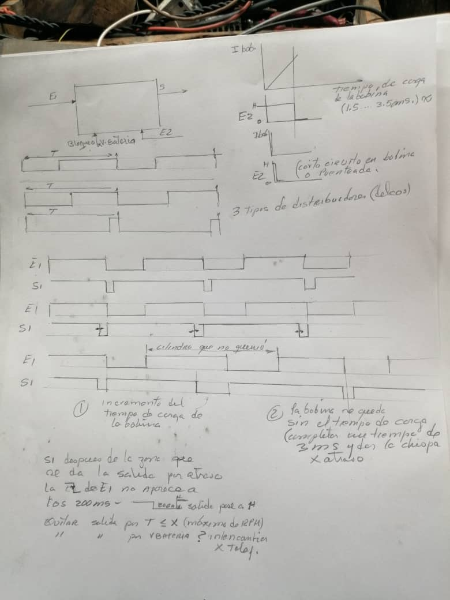
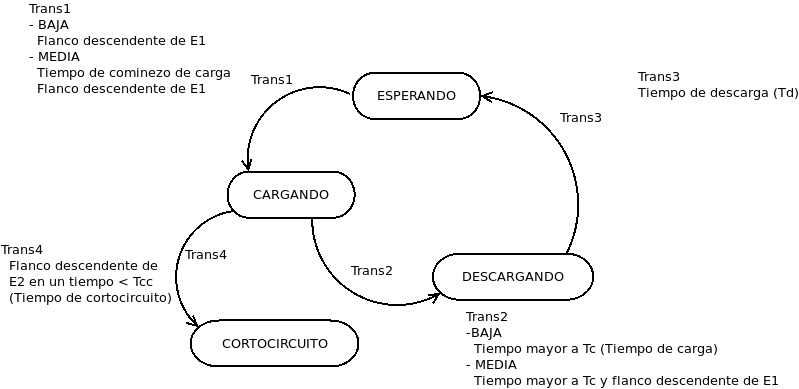
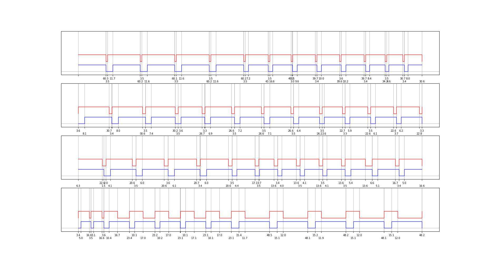

# Encendido — control del disparo de la bobina a partir del sensor del delco

Controlador de encendido electrónico para motores de combustión interna de
cuatro tiempos, sobre STM32F103 ("Blue Pill"). Lee la señal del distribuidor
(delco) y decide cuándo cargar y cuándo descargar la bobina, en lugar de dejar
que lo decida la geometría del sensor.

**Proyecto de 2021. Se quedó en banco de pruebas; no hay constancia de que
llegara a montarse en un motor.**

---

## Autoría

La **idea es de Casanova** (Santa Clara), especialista en circuitos para
automóviles. Suyos son el planteamiento del problema, el diagrama de bloques,
los cronogramas y los requisitos — están manuscritos en
[`docs/img/notas-casanova-hoja-completa.jpg`](docs/img/notas-casanova-hoja-completa.jpg)
y fechados el 17 de mayo de 2021.

Mío es lo que hay en este repositorio: el firmware del controlador, el banco de
pruebas (generador de señal y analizador lógico) y el procesado de las
capturas.

Es el mismo equipo de trabajo del proyecto
[`electro`](https://github.com/vladimir1284/electro).



---

## El problema

En un encendido convencional el tiempo que la bobina pasa cargándose lo fija la
geometría del sensor del delco: el ángulo de leva. Ese ángulo es fijo, así que
el tiempo de carga sale proporcional al período, es decir, inversamente
proporcional a las revoluciones. A bajas revoluciones la bobina se carga de
sobra y se calienta; a altas revoluciones no le da tiempo y la chispa pierde
energía.

La idea es desacoplar las dos cosas: usar el flanco del delco **solo** como
referencia de cuándo tiene que saltar la chispa, y controlar el tiempo de carga
por separado, con el microcontrolador, para que sea siempre el que la bobina
necesita.

Los requisitos de Casanova, tal como están en la hoja:

1. **Incrementar el tiempo de carga de la bobina.**
2. **Que la bobina no se quede sin tiempo de carga** — completar un tiempo de
   carga de 3 ms aunque haya que atrasar la chispa.
3. Reconocer **tres tipos de distribuidores (delcos)** con relaciones de trabajo
   distintas.
4. **Bloqueo por voltaje de batería**, y evitar disparos espurios por `T ≤ X`
   (máximo de RPM).
5. Detectar **cortocircuito en la bobina o bobina puenteada**.

---

## Las señales

```
        ____________
  E1   |            |
  ---->|            |   S
  E2   | Controller |---->
  ---->|            |
       |____________|
```

| Señal | Qué es |
|-------|--------|
| `E1`  | Señal del delco. El disparo se referencia al **flanco descendente**. |
| `E2`  | Salida de un comparador sobre la corriente de la bobina. Su flanco indica **bobina totalmente cargada**. Si llega antes de `Tcc` se considera cortocircuito. |
| `S`   | Control de la bobina: `LOW` = carga, `HIGH` = descarga (chispa). |

`E2` es la realimentación que hace interesante el diseño: en vez de confiar en
un tiempo de carga fijo, el controlador **mide** cuánto tardó la bobina en
cargarse de verdad y ajusta el tiempo para la próxima vez. Con esa misma señal
detecta el cortocircuito, porque una bobina en corto "carga" en mucho menos
tiempo del posible.

### Pinout

| Señal | Pin |
|-------|-----|
| `E1` — entrada del delco | `PB12` |
| `E2` — bobina cargada (comparador) | `PB14` |
| `S` — control de la bobina | `PB15` |
| Salida de aviso: carga demasiado rápida | `PB0` |
| Salida de aviso: cortocircuito en la bobina | `PB1` |
| LED de depuración (ventana de descarga) | `PC13` |
| Consola de depuración | `Serial`, 115200 bps |

---

## Lógica de control



Cinco estados: `ESPERANDO`, `CARGANDO`, `DESCARGANDO`, `CORTOCIRCUITO` y
`CALCULANDO` (este último declarado pero nunca usado).

Por encima de la máquina de estados hay tres **regímenes de motor**, con
histéresis de `BRECHA_rpm`:

| Régimen | RPM | Cómo arranca la carga |
|---------|-----|------------------------|
| `BAJA`  | hasta `LIMITE_BAJA` (500) | al llegar el flanco descendente de `E1` |
| `MEDIA` | hasta `LIMITE_MEDIA` (1500) | **antes** del flanco, en el instante estimado `Tfd_E1 + periodoE1 - tiempoDeCarga` |
| `ALTA`  | por encima | declarado, sin transición de entrada implementada |

Esa es la respuesta al requisito 2: a partir de cierta velocidad el período ya
no da para cargar la bobina si se empieza en el flanco, así que el controlador
**predice** el próximo flanco a partir del período medido y empieza a cargar
antes.

El tiempo de descarga `Td` baja linealmente con las revoluciones, entre
`Td_max` (20 ms) y `Td_min` (1.5 ms).

### Parámetros

| Constante | Valor | Qué es |
|-----------|-------|--------|
| `RPM_0` | 300 | velocidad que se asume al arrancar |
| `MAXRPM` | 6000 | velocidad máxima de trabajo |
| `LIMITE_BAJA` | 500 rpm | frontera BAJA → MEDIA |
| `LIMITE_MEDIA` | 1500 rpm | frontera MEDIA → ALTA |
| `BRECHA_rpm` | 50 rpm | histéresis de cambio de régimen |
| `Tcc` | 1000 µs | por debajo de esto, la bobina está en corto |
| `Tci` | 3500 µs | tiempo de carga inicial |
| `Tcm` | 1500 µs | tiempo de carga mínimo |
| `Td_min` / `Td_max` | 1500 / 20000 µs | tiempo de descarga |
| `NSAMPLES` | 5 | lecturas seguidas para validar un flanco |

La conversión a revoluciones es `rpm = 30e6 / periodo`, porque en un motor de
cuatro tiempos dos períodos completos de `E1` son una vuelta.

### Rechazo de ruido

`EdgeDetector` ([`firmware/encendido/edge_detector.cpp`](firmware/encendido/edge_detector.cpp))
no se fía de una sola lectura: tras el primer cambio exige `NSAMPLES` = 5
lecturas consecutivas del mismo valor antes de dar el flanco por bueno, y se
reinicia si aparece una lectura contraria. Es la misma idea que en `electro`,
por el mismo motivo: la instalación eléctrica de un carro es ruidosa.

`prepare()` fuerza el estado interno al valor actual de la pata, para no
perder un flanco que llegue inmediatamente después de empezar a cargar.

---

## Banco de pruebas

No había motor, así que se construyó uno de mentira:

- **Generador de la señal del delco**: un **ESP32 con MicroPython**
  ([`tools/generador-esp32/signGne.py`](tools/generador-esp32/signGne.py)) que
  saca por `Pin(2)` una onda cuadrada con relación de trabajo del 80 % y va
  recorriendo una lista de regímenes — 400, 550, 700, 800, 900, 1000, 1400,
  1200, 600 y 400 rpm — para ver cómo responde el controlador a la aceleración
  y a la desaceleración.
- **Analizador lógico**: un segundo STM32 con una versión modificada del
  proyecto *logic-analyzer* de Vincenzo
  ([`tools/analizador-logico/`](tools/analizador-logico/)). Captura `PB12`–`PB15`
  por sondeo, guarda solo los cambios con su marca de tiempo en microsegundos y
  los vuelca por serie.
- **Visualización**:
  [`tools/showLogicDiagram.py`](tools/showLogicDiagram.py) pide una captura con
  `G<n>`, reconstruye los niveles a partir del estado inicial y de la máscara de
  cambios, y dibuja las tres señales con matplotlib, anotando debajo el tiempo
  en milisegundos entre flancos.



### Qué se midió

En [`docs/experimentos/`](docs/experimentos/) están las capturas, en JPG y en
EPS. En todas, de abajo hacia arriba: `E1` (azul, la señal del delco), `S`
(rojo, el control de la bobina — los escalones hacia abajo son las ventanas de
carga) y `E2` (verde). Los números bajo el eje son los milisegundos entre
flancos consecutivos.

| Archivo | Qué prueba |
|---------|------------|
| `comportamiento_E2_1.5ms` | `E2` a 1.5 ms: la carga converge al mínimo `Tcm` |
| `comportamiento_E2_2.2ms` | `E2` a 2.2 ms: la carga converge a 2.2 ms |
| `comportamiento_E2_2.9ms` | `E2` a 2.9 ms |
| `comportamiento_E2_mayor_q_3.5ms` | `E2` por encima de `Tci`: la carga se queda en 3.5 ms |
| `condicion_erronea_E2_1.1ms_carga_1.5ms` | la bobina carga antes de lo esperado: se activa el aviso de `PB0` |
| `corotocircuito_E2_800us` | `E2` a 800 µs, por debajo de `Tcc`: se detecta cortocircuito |
| `Tiempo_de_descarga` | barrido de velocidad completo, con `Td` reduciéndose al subir las revoluciones |

Esa tabla es, en la práctica, la demostración de que la realimentación por `E2`
hace lo que debía: el tiempo de carga sigue a la bobina en vez de a la
geometría del delco.

En [`docs/datos/`](docs/datos/) quedan los datos crudos: `temp.csv` (volcado de
ocho canales etiquetados por color de cable) y `stored_data.p`, la captura
guardada que usa `showLogicDiagram.py` en modo fuera de línea. `stored_data.p`
es un *pickle* de Python: solo debe cargarse si se confía en su origen.

---

## Estado del código

Hay que leer esta sección antes de compilar nada.

**El código fuente que está en `firmware/encendido/` no es el que se probó.**
El fuente es de diciembre de 2021; el binario y los artefactos de compilación
son del 2 de junio de 2021, y la diferencia no es cosmética: en la versión que
se compiló y se midió, **la realimentación por `E2` está activa**. En el fuente
posterior está comentada. Es decir, el fuente más nuevo es el menos capaz de
los dos.

Lo que la versión de junio tiene y la de diciembre no:

- `detector_E2` instanciado (en el fuente actual está comentado).
- Dentro de `CARGANDO`, la detección del flanco de `E2`, la comprobación de
  cortocircuito contra `Tcc` y la llamada a `actualizarTiempoDeCarga()`. En el
  fuente actual todo ese bloque está comentado, de modo que
  `actualizarTiempoDeCarga()` queda definida pero nunca se llama y
  `ERROR_BOBINA_PIN` nunca cambia.
- `cargarBobina()` llama a `detector_E2.prepare()`.
- Una función `descargarBobina()` aparte.
- Con `DEBUG` activo usa `detect_rising()` sobre `E2` en lugar de
  `detect_falling()`, porque el generador del banco daba la señal invertida
  respecto al comparador real.

Esa versión está preservada tal cual en
[`firmware/compilado-2021-06/`](firmware/compilado-2021-06/): el preprocesado
`encendido.ino.cpp` que produjo el IDE y el binario `encendido.ino.bin`.

Otras cosas que conviene saber:

- **`EdgeDetector::detect_falling()`, `detect_rising()` y `prepare()` están
  declaradas `bool` y no devuelven nada.** Es comportamiento indefinido. En
  ARM GCC sin optimización funciona de casualidad, porque el valor de retorno
  de `detect_edge()` se queda en `r0`, que es justo donde el llamante busca el
  resultado. No es una base sobre la que montar un encendido.
- **`const float m = 4*(Td_max - Td_min) / (MAXRPM - RPM_0);` se evalúa en
  aritmética entera** antes de convertirse a `float`: 74000 / 5700 da 12 en vez
  de 12.98, un 7 % de error en la pendiente. (El factor 4 extra, en cambio,
  parece deliberado: hace que `Td` llegue a su mínimo hacia las 1500 rpm en
  lugar de a las 6000.)
- El régimen `ALTA` y el estado `CALCULANDO` están declarados pero no tienen
  transición de entrada.
- Los requisitos 3 (tres tipos de delco), 4 (bloqueo por voltaje de batería) y
  la parte de `T ≤ X` no están implementados.
- `DEBUG` está en `true`. Con `DEBUG` activo el `loop()` imprime por serie cada
  500 ms, lo que no es aceptable en un encendido real.
- No hay esquemático. El circuito de acondicionamiento de `E1` y el comparador
  de corriente que produce `E2` no están documentados; de la etapa de entrada
  solo queda la pantalla de una calculadora de disparador de Schmitt que se
  consultó entonces, y no se incluye aquí por ser material de terceros.

---

## Compilación

Sketch de Arduino con el core
[stm32duino STM32F1](https://github.com/rogerclarkmelbourne/Arduino_STM32).

- Placa: `stm32duino:STM32F1:genericSTM32F103C`
- Variante: `STM32F103CB`
- Reloj: 72 MHz
- Carga: **ST-Link**

```
firmware/encendido/encendido.ino
```

---

## Estructura del repositorio

```
firmware/encendido/          Fuente tal como quedó en diciembre de 2021
├── encendido.ino            Parámetros, máquina de estados, regímenes
└── edge_detector.{h,cpp}    Detección de flancos con rechazo de ruido

firmware/compilado-2021-06/  Lo que de verdad se compiló y se midió
├── encendido.ino.cpp        Preprocesado del IDE, con E2 activa
└── encendido.ino.bin        Binario

tools/
├── generador-esp32/         Generador de la señal del delco (MicroPython)
├── analizador-logico/       Analizador lógico modificado (GPL-3.0)
└── showLogicDiagram.py      Captura y dibujo de las señales

docs/
├── img/                     Notas de Casanova, FSM, captura de ejemplo
├── experimentos/            Capturas de las pruebas (JPG y EPS)
├── datos/                   Datos crudos y fuente del diagrama de estados
└── referencias.md           Bibliografía consultada
```

---

## Licencia

MIT — ver [LICENSE](LICENSE), **excepto** `tools/analizador-logico/`, que es
obra derivada de un proyecto GPL-3.0 y conserva esa licencia.
